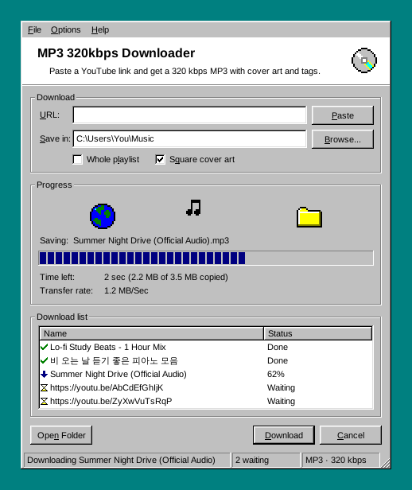

# MP3 320kbps Downloader



[English](#english) · [한국어](#한국어)

## English

Paste a YouTube link and get a **320 kbps MP3** with the cover art and tags already filled in.
The window looks like a Windows 98 program. Built with Python (Tkinter), yt-dlp and FFmpeg.

### How it works

```
YouTube link → yt-dlp (best audio) → FFmpeg → 320 kbps MP3 + cover art + tags
```

### Features

| Feature | What it does |
| :--- | :--- |
| 320 kbps MP3 | Downloads the best audio YouTube offers and converts it to a 320 kbps MP3. |
| Cover art | The video thumbnail is embedded in the MP3 as album art. |
| Square cover art | Crops the 16:9 thumbnail to a centred square, like a real album cover. On by default. |
| Tags | Fills in title, artist (or the channel name) and date. |
| Download list | Add as many links as you like. They wait in the list and download one after another. |
| Whole playlist | With this on, a playlist link downloads every song in it. With it off, only the one video. |
| Cancel / Retry | Stops the current download and cleans up the half-finished files. Failed or cancelled items can be retried. |

### Window

- **Download** – The link box, the folder the MP3s go to, and the two options.
- **Progress** – A note flies from the globe to the folder while a song downloads, like the old Internet Explorer download dialog. Below it: the song being saved, a progress bar, time left and transfer rate.
- **Download list** – Every link you added, with its status: waiting, a percentage, converting, done or error.
- **Status bar** – What is happening right now and how many links are still waiting.

### Usage

1. Copy a link from YouTube (a video or a playlist).
2. Click **Paste** (or press Ctrl+V in the URL box).
3. Click **Download** (or press Enter).
4. When it's done, click **Open Folder**, or double-click the song in the list to show the MP3 in its folder.

Tips:

- You can paste several links at once, separated by spaces or new lines.
- You can keep adding links while something is downloading.
- Right-click a song in the list to retry it, copy its link or remove it. Double-click a failed one to see what went wrong.
- Every underlined letter works with Alt, e.g. **Alt+D** for Download, **Alt+P** for Paste.
- Drag the bottom-right corner to make the window bigger.
- The download folder and the options are remembered for next time.
- On Windows 11 the title bar turns navy and the window corners become square.

### Installation

1. Download `MP3_320kbps_Downloader.exe` from [Releases](../../releases).
2. Run it. FFmpeg and everything else it needs are inside the exe.
3. If Windows SmartScreen warns about an unknown app, click **More info → Run anyway**.

### Updates

You don't need to come back here for new versions.

- Every day, GitHub Actions checks whether yt-dlp (the part that talks to YouTube) has a new version. If it does, a new exe is built, tested and published automatically, and the old release is removed.
- The exe checks for a new release a few seconds after it starts. If there is one, it asks **"Update now?"**. Click **Yes** and it downloads the new exe, checks it, replaces itself and restarts.
- Click **No** and it won't ask again until the next version. **Help → Check for Updates...** checks right away.
- If the update can't replace the file (for example because the exe is in a folder you can't write to), it offers to open the download page instead.

### Running from source

Requirements: Python 3.10 or newer.

```bash
pip install -r requirements.txt
python main.py
```

`requirements.txt` also installs FFmpeg (`imageio-ffmpeg`) and the Deno JavaScript runtime (`deno`), so there is nothing else to download.
If you want to use your own FFmpeg instead, put `ffmpeg.exe` next to `main.py` or add it to PATH.

### Building the .exe

```bash
pip install -r requirements.txt pyinstaller
python build.py --version 2.0.0
```

The exe ends up in `dist/MP3_320kbps_Downloader.exe`, with FFmpeg and Deno packed inside.
You normally don't need to do this: the release workflow builds and publishes the exe for you
(**Actions → Release → Run workflow** to do it by hand).

| File | Contents |
| :--- | :--- |
| `main.py` | Starts the app |
| `app.py` | The window: link box, progress, download list, menus, settings |
| `downloader.py` | The download queue: runs yt-dlp on a background thread, crops the cover, finds FFmpeg and Deno |
| `win98.py` | Windows 98 widgets drawn by hand: buttons, check boxes, group boxes, progress bar, message boxes, pixel-art icons |
| `updater.py` | Checks GitHub Releases for a newer exe, downloads it and swaps it in |
| `build.py` | Builds the single-file exe with PyInstaller |
| `.github/workflows/release.yml` | Builds, tests and publishes the exe on Windows; runs daily for new yt-dlp versions |
| `icon.ico` | Program icon |

### Troubleshooting

| Message | Fix |
| :--- | :--- |
| `ffmpeg-location ffmpeg.exe does not exist` / `ffprobe and ffmpeg not found` | Version 1 only looked for `ffmpeg.exe` in the folder you started it from. Version 2 finds it by itself: run `pip install -r requirements.txt` again. |
| `No supported JavaScript runtime could be found` | YouTube now needs a JavaScript runtime. `pip install -r requirements.txt` installs Deno for you. |
| HTTP 403, or "confirm you're not a bot" | YouTube changed something. Use **Help → Check for Updates...**, or from source run `pip install -U "yt-dlp[default,deno]"`. |

### Credits

Made by wxxmin.

Uses [yt-dlp](https://github.com/yt-dlp/yt-dlp), [FFmpeg](https://ffmpeg.org) (via [imageio-ffmpeg](https://github.com/imageio/imageio-ffmpeg)) and [Deno](https://deno.com).
Please only download videos you have the right to save.

---

## 한국어

YouTube 링크를 붙여넣으면 앨범 커버와 태그가 들어간 **320 kbps MP3**로 저장해 주는 프로그램입니다.
창은 Windows 98 프로그램처럼 생겼습니다. Python(Tkinter), yt-dlp, FFmpeg로 만들었습니다.

### 동작 방식

```
YouTube 링크 → yt-dlp (가장 좋은 음질) → FFmpeg → 320 kbps MP3 + 앨범 커버 + 태그
```

### 기능

| 기능 | 하는 일 |
| :--- | :--- |
| 320 kbps MP3 | YouTube에서 가장 좋은 음질의 오디오를 받아 320 kbps MP3로 변환합니다. |
| 앨범 커버 | 영상 썸네일을 MP3에 앨범 커버로 넣습니다. |
| 정사각형 커버 | 16:9 썸네일의 가운데를 정사각형으로 잘라 진짜 앨범 커버처럼 만듭니다. 기본으로 켜져 있습니다. |
| 태그 | 제목, 아티스트(없으면 채널 이름), 날짜를 채워 넣습니다. |
| 다운로드 목록 | 링크를 원하는 만큼 추가할 수 있습니다. 목록에서 기다렸다가 하나씩 차례로 받습니다. |
| 재생목록 전체 | 켜면 재생목록 링크의 모든 곡을 받고, 끄면 그 영상 하나만 받습니다. |
| 취소 / 다시 시도 | 지금 받는 곡을 멈추고 받다 만 파일을 정리합니다. 실패하거나 취소한 항목은 다시 시도할 수 있습니다. |

### 화면

- **Download** – 링크 입력칸, MP3를 저장할 폴더, 옵션 두 개.
- **Progress** – 곡을 받는 동안 옛날 인터넷 익스플로러 다운로드 창처럼 음표가 지구본에서 폴더로 날아갑니다. 아래에는 저장 중인 곡, 진행 막대, 남은 시간, 전송 속도가 나옵니다.
- **Download list** – 추가한 링크와 상태(대기, 진행률, 변환 중, 완료, 오류).
- **상태 표시줄** – 지금 하고 있는 일과 남은 링크 개수.

### 사용법

1. YouTube에서 링크를 복사합니다 (영상 또는 재생목록).
2. **Paste**를 누릅니다 (또는 URL 칸에서 Ctrl+V).
3. **Download**를 누릅니다 (또는 Enter).
4. 다 받으면 **Open Folder**를 누르거나, 목록에서 곡을 더블클릭하면 MP3가 있는 폴더가 열립니다.

팁:

- 링크 여러 개를 띄어쓰기나 줄바꿈으로 구분해서 한 번에 붙여넣을 수 있습니다.
- 다운로드 중에도 링크를 계속 추가할 수 있습니다.
- 목록에서 곡을 오른쪽 클릭하면 다시 시도, 링크 복사, 목록에서 지우기를 할 수 있습니다. 실패한 항목을 더블클릭하면 이유가 나옵니다.
- 밑줄 친 글자는 Alt와 같이 누르면 됩니다. 예: **Alt+D** 다운로드, **Alt+P** 붙여넣기.
- 오른쪽 아래 모서리를 드래그하면 창을 키울 수 있습니다.
- 저장 폴더와 옵션은 다음에 켤 때도 그대로 남아 있습니다.
- Windows 11에서는 제목 표시줄이 남색으로 바뀌고 창 모서리가 각지게 됩니다.

### 설치

1. [Releases](../../releases)에서 `MP3_320kbps_Downloader.exe`를 받습니다.
2. 실행합니다. FFmpeg 등 필요한 것은 exe 안에 다 들어 있습니다.
3. Windows SmartScreen이 경고하면 **추가 정보 → 실행**을 누릅니다.

### 업데이트

새 버전을 받으러 여기 다시 올 필요가 없습니다.

- GitHub Actions가 매일 yt-dlp(YouTube와 통신하는 부분)에 새 버전이 나왔는지 확인합니다. 나왔으면 새 exe를 자동으로 빌드하고 테스트해서 올리고, 예전 릴리스는 지웁니다.
- exe는 켜지고 몇 초 뒤에 새 릴리스가 있는지 확인합니다. 있으면 **"Update now?"** 라고 묻고, **Yes**를 누르면 새 exe를 받아 검사한 뒤 자기 자신을 바꾸고 다시 시작합니다.
- **No**를 누르면 다음 버전이 나올 때까지 다시 묻지 않습니다. **Help → Check for Updates...** 로 바로 확인할 수도 있습니다.
- 파일을 바꿀 수 없으면 (예: 쓰기 권한이 없는 폴더에 exe가 있을 때) 대신 다운로드 페이지를 열어 줍니다.

### 소스로 실행하기

필요한 것: Python 3.10 이상.

```bash
pip install -r requirements.txt
python main.py
```

`requirements.txt`가 FFmpeg(`imageio-ffmpeg`)와 Deno 자바스크립트 런타임(`deno`)도 같이 설치하기 때문에 따로 받을 것이 없습니다.
직접 받은 FFmpeg를 쓰고 싶으면 `ffmpeg.exe`를 `main.py`와 같은 폴더에 두거나 PATH에 추가하세요.

### exe 만들기

```bash
pip install -r requirements.txt pyinstaller
python build.py --version 2.0.0
```

`dist/MP3_320kbps_Downloader.exe`에 FFmpeg와 Deno가 들어간 exe가 만들어집니다.
보통은 직접 할 필요가 없습니다. 릴리스 워크플로가 exe를 빌드해서 올려 줍니다
(직접 돌리려면 **Actions → Release → Run workflow**).

| 파일 | 내용 |
| :--- | :--- |
| `main.py` | 프로그램 시작 |
| `app.py` | 창: 링크 입력, 진행 상황, 다운로드 목록, 메뉴, 설정 저장 |
| `downloader.py` | 다운로드 대기열: 백그라운드 스레드에서 yt-dlp 실행, 커버 자르기, FFmpeg와 Deno 찾기 |
| `win98.py` | 직접 그린 Windows 98 위젯: 버튼, 체크박스, 그룹 상자, 진행 막대, 메시지 창, 픽셀 아트 아이콘 |
| `updater.py` | GitHub Releases에서 새 exe를 확인하고, 받아서 교체 |
| `build.py` | PyInstaller로 exe 파일 하나 만들기 |
| `.github/workflows/release.yml` | Windows에서 exe를 빌드·테스트·게시. yt-dlp 새 버전을 확인하려고 매일 실행 |
| `icon.ico` | 프로그램 아이콘 |

### 문제 해결

| 메시지 | 해결 방법 |
| :--- | :--- |
| `ffmpeg-location ffmpeg.exe does not exist` / `ffprobe and ffmpeg not found` | 1.0 버전은 프로그램을 실행한 폴더에서만 `ffmpeg.exe`를 찾았습니다. 2.0은 알아서 찾으니 `pip install -r requirements.txt`를 다시 실행하세요. |
| `No supported JavaScript runtime could be found` | 이제 YouTube는 자바스크립트 런타임이 필요합니다. `pip install -r requirements.txt`가 Deno를 설치해 줍니다. |
| HTTP 403, "confirm you're not a bot" | YouTube가 뭔가 바꾼 것입니다. **Help → Check for Updates...** 를 누르거나, 소스로 실행 중이면 `pip install -U "yt-dlp[default,deno]"`를 실행하세요. |

### 크레딧

wxxmin이 만들었습니다.

[yt-dlp](https://github.com/yt-dlp/yt-dlp), [FFmpeg](https://ffmpeg.org) ([imageio-ffmpeg](https://github.com/imageio/imageio-ffmpeg)로 설치), [Deno](https://deno.com)를 사용합니다.
저장할 권리가 있는 영상만 받아 주세요.
